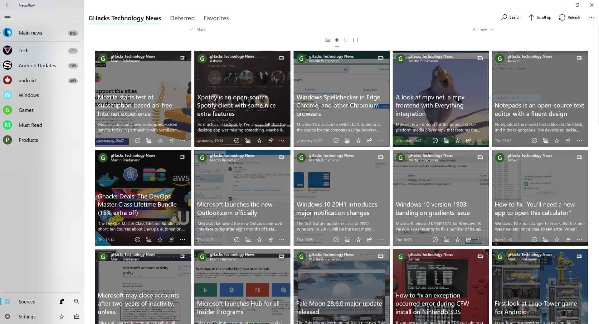
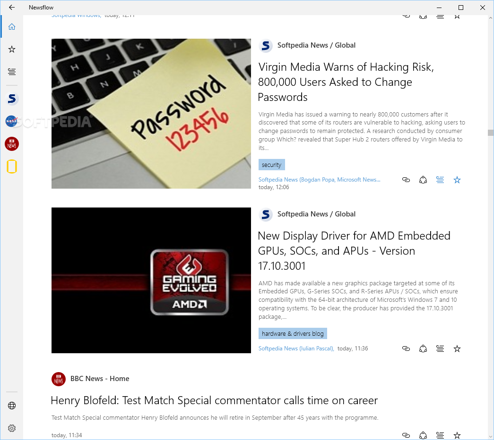

# Newsflow RSS Reader for Organized Windows Reading

Follow website updates in one Windows reading workspace.
Newsflow collects feed entries locally and helps you return to stories that matter.

[](https://github.com/newsflow-rss-reader/newsflow-rss/releases/)

## Why Newsflow

A Newsflow RSS collection brings subscribed publications into a shared reading routine.
Browse new entries, organize sources, and keep selected stories for another session.

- Collect updates directly from subscribed feeds.
- Read downloaded news when you are offline.
- Separate publications into useful categories.
- Keep favorites apart from articles saved for later.
- Search collected news instead of reopening every source.
- Read supported article content inside the application.

## Feature Highlights

| Reading task | Newsflow capability | Practical distinction |
| --- | --- | --- |
| Follow publications | RSS, Atom, and RDF feeds | Requires a usable feed from the publisher |
| Read offline | Local news storage | Download content before disconnecting |
| Organize sources | Feed categories | Group related publications together |
| Save interesting stories | Favorites | Keep a personal selection |
| Defer an article | Read later | Maintain a separate reading queue |
| Reduce repeated reading | Read and unread states | Track progress through collected entries |
| Move subscriptions | OPML import and export | Transfers feed lists |
| Inspect an article | Extended readability | Results depend on the source content |
| Follow fresh entries | Notifications | Uses updates received by the app |



## Read Your Way

The Newsflow RSS reader combines a feed overview with individual article reading.
Use the overview to decide what deserves attention before opening a story.

### Article Content

Extended readability offers an in-app way to view supported article content.
The result depends on what the publisher makes available.

Some feeds contain complete articles.
Others provide summaries that require access to the original publication.

- View article images where available.
- Read supported content without leaving the app.
- Watch supported YouTube and HTML video content.
- Display GIF animations included with articles.

Embedded media may require a connection even when a news entry is stored locally.
Treat a downloaded entry and a fully available offline article as separate things.

### Reading Orientation

The application supports portrait and landscape layouts.
Choose the orientation that suits the device and the length of the article.

## Stay on Top of Your Timeline

A Newsflow news reader collection becomes easier to browse when its categories have clear purposes.
Use categories for subjects you revisit regularly.

- Put work-related publications in one category.
- Keep personal interests in another.
- Reserve favorites for stories you expect to revisit.
- Use read later for items that still need your attention.
- Mark completed entries as read.

### A Practical Reading Cycle

1. Review newly collected entries.
2. Open the stories that are relevant now.
3. Save longer articles to read later.
4. Favorite material that deserves a second visit.
5. Mark finished stories as read.

This is a suggested workflow using the application's documented reading controls.
Adapt the categories and saved lists to your own habits.

### Search and Filtering

Search helps locate a particular story in the news collection.
Keyword grouping and filtering offer additional ways to narrow what you see.

Use a publication name, distinctive phrase, or subject when looking for a known item.
Check the chosen category if the expected story does not appear.

## Discover and Manage Sources

The Newsflow news aggregator includes feed discovery for websites and keyword searches.
A website can expose several feeds for different subjects or sections.

Review the feed title before adding it.
A narrowly focused feed may be easier to follow than an entire publication.

### Check a Feed Response

The following example uses Windows PowerShell, independently of Newsflow.
Set `$FeedUrl` to a feed address before running these read-only inspection commands.

```powershell
$response = Invoke-WebRequest -Uri $FeedUrl -UseBasicParsing
[xml]$feedDocument = $response.Content
$feedDocument.DocumentElement.LocalName
```

The result identifies the XML root element returned by the server.
This check does not validate every feed field or guarantee that Newsflow can parse the response.

### Keep Feed Lists Portable

Newsflow supports OPML import and export.
Use an exported subscription list when moving or preserving your source collection.

An OPML list describes subscriptions rather than downloaded article bodies.
Keep its role separate from the application's backup and restore feature.

```xml
<opml version="2.0">
  <head><title>Reading Sources</title></head>
  <body>
    <outline text="Research">
      <outline text="Selected Publication" type="rss" xmlUrl="FEED_URL" />
    </outline>
  </body>
</opml>
```

This is a standard OPML example, not a Newsflow settings file.
Replace `FEED_URL` with a valid feed address before importing it.

## Keep Control of Stored News

Newsflow downloads feed news directly to the device and stores it locally.
Refresh the collection while connected before relying on it away from a network.

- Confirm that important entries have been downloaded.
- Open essential articles before going offline.
- Remember that external media can remain network-dependent.
- Keep a separate copy of an exported subscription list.

The Store description also lists backup, restore, and synchronization between devices.
Check the controls available in your installed package before planning a migration.
Do not assume that an OPML export preserves reading history or article content.



## Notifications and Windows Integration

Newsflow breaking news notifications can draw attention to newly received entries.
Their usefulness depends on feed publication timing and the application's refresh behavior.

Notifications are feed update alerts rather than a guaranteed real-time news service.
Use them alongside a deliberate review of your source collection.

The published feature list includes Windows Live Tiles.
That feature belongs to the original Windows environment and depends on shell support.

## Package Identity and Version

The Microsoft catalog identifies the application as Newsflow, published by MaxN.
The catalog includes the Windows package version `2.1.12.1000`.

To inspect an existing installation, use this Windows PowerShell query.
It reports the local package and does not download or update Newsflow.

```powershell
Get-AppxPackage -Name '6958MaxN.Newsflow' |
    Select-Object Name, Version, PackageFamilyName
```

The installed version can differ from a catalog entry.
Availability also depends on the Store and the device environment.

## Documentation Scope

This overview describes the Windows RSS application named Newsflow.
Its feature summary follows the published Store description and catalog metadata.

Examples use standard OPML and Windows PowerShell.
They are supporting inspection tools rather than a Newsflow command-line interface.

## Related Search Terms

newsflow rss, newsflow rss reader, newsflow news reader, newsflow news aggregator, newsflow breaking news, rss, rss-reader, feed-reader, news-aggregator, atom, opml, offline, windows, news
